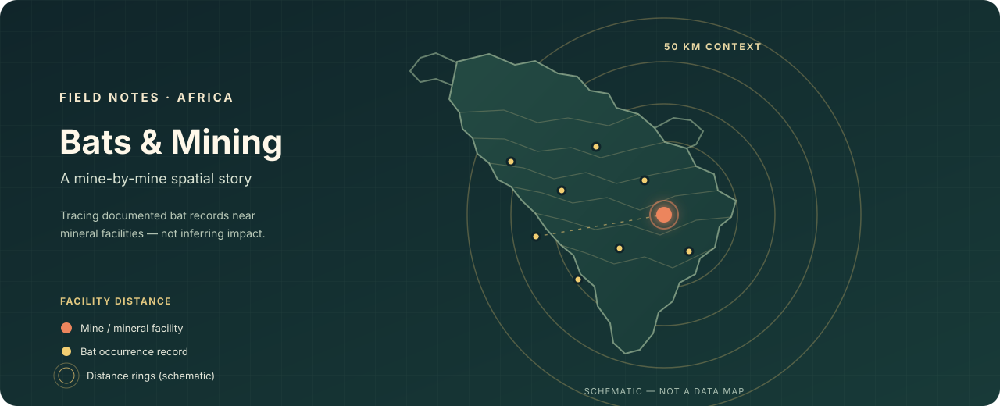

<div align="center">

# African Bats & Mining: A StoryMap

### Exploring where documented bat records and mineral facilities meet across Africa

<a href="#the-storymap"></a>

<p><a href="https://jltobias.github.io/JupyterLite-AfricanBatDatabase/storymap/"><strong>Launch the StoryMap</strong></a></p>

**JupyterGIS storymap** · reproducible notebooks · open data

</div>

> **Deployment status:** The Book, JupyterLite Lab, and StoryMap are live on GitHub Pages and are published by GitHub Actions.

| Explore | Link |
|---|---|
| **Jupyter Book** — data, methods, results, and image credits | [Read the book](https://jltobias.github.io/JupyterLite-AfricanBatDatabase/book/) |
| **JupyterLite Lab** — run the analysis notebook in your browser | [Open JupyterLite](https://jltobias.github.io/JupyterLite-AfricanBatDatabase/lab/) |
| **JupyterGIS StoryMap** — step through mines and mineral-resource features | [Launch the StoryMap](https://jltobias.github.io/JupyterLite-AfricanBatDatabase/storymap/) |
| **Native JupyterGIS story** | [Open the `.jGIS` project in JupyterLite](https://jltobias.github.io/JupyterLite-AfricanBatDatabase/lab/index.html?path=african_bat_mines_story.jGIS) |
| **Notebook.link** — open the repository's notebook and files in the browser | [Open this project in Notebook.link](https://notebook.link/github/jltobias/JupyterLite-AfricanBatDatabase/tree/main/) |
| **References** — data sources, bat species, and Ebola evidence | [Read the bibliography](REFERENCES.md) |

## Current build

- **17,285** point records in the supplied shapefile; **17,255** valid coordinates are retained at their original precision, and 30 invalid sentinel coordinates are excluded.
- **848** geocoded facilities from the USGS 2006 Africa and Middle East inventory and **232** USGS 2017 critical-mineral point features in countries represented by the bat data.
- **One separately cited Kibali Gold Mine location** from Wikidata is added because it is absent from both USGS sources.
- **290** mine pages and **195** critical-mineral resource-feature pages have at least one bat record within 50 km.
- Those **485** location pages contain **4,387** unique bat records and **10,340** location-to-record distance matches across **207** scientific names.

The counts are generated from the exact input versions documented below and can be reproduced with `python scripts/build_data.py`.

## The storymap

The experience follows a **location-to-location narrative**: each page introduces a 2006 USGS facility classified as a mine, a selected 2017 USGS critical-mineral point, or the separately sourced Kibali mine, when bat records occur within 50 km. The 2017 source includes mines, deposits, districts, and regions but does not classify the individual points, so the StoryMap labels them as unclassified resource features rather than mines. The pacing takes inspiration from [Esri's *One World, Many Voices*](https://storymaps.esri.com/stories/endangered-languages/), with original project design. The static StoryMap provides interactive labels, accessible species cards, location navigation, source-credited photos, and on-demand buffer controls. A native `.jGIS` guided story, source data, and seven toggleable location-centered distance-band layers are included in JupyterLite.

Each location page pairs source attributes with a photograph only when a correctly identified and reusable site image is available. If no site-specific image is verified, it says so rather than misidentifying another mine. Bat photographs are used as species illustrations and are not represented as the animals at a mapped locality. The map:

- Keep the selected location prominent and show its country, commodity, type, status, mining method, operator, and capacity when recorded.
- Label nearby points by **genus and species**; hover previews a species card and click, tap, or keyboard focus can open it.
- Show verified English bat names in parentheses on map labels and nearby-record entries.
- Filter mine and resource-feature pages by country and location, and export the selected location's 50 km species summary using the browser's print-to-PDF dialog.
- Calculate facility-to-point distances with WGS 84 ellipsoidal geodesics and assign records to non-overlapping bands: 0–1, 1–5, 5–10, 10–20, 20–30, 30–40, and 40–50 km.
- Include those seven geodesic distance bands as separate, initially hidden polygon layers in the native JupyterGIS project. The layers are centered on locations represented in the story and show the corresponding occurrence-record count.
- Let readers draw one or more 1, 5, 10, 20, 30, 40, and 50 km circles from either the selected facility or a selected bat point. Bat-centered circles are rendered on demand to avoid obscuring other points.
- Show English names, diet, foraging information, and disease context only when there is a cited species-level source. A radius chosen for this spatial analysis is not a foraging range.

### A clearer view than an all-labels map

The supplied example shows why every species name and every set of overlapping circles should not be drawn at once. The StoryMap reduces clutter by:

- Showing circles only on demand for the selected point or mine, using thin outlines instead of opaque overlapping fills.
- Using compact, high-contrast species labels in hover tooltips and cards rather than drawing every label permanently.
- Keeping the selected-location marker visually distinct from bat records, and using a legend that states what each buffer is centered on.
- Putting detailed species traits and photographs in an inspectable popup/story card rather than permanently labeling the map; the card will open on hover, click, tap, or keyboard focus.
- Supporting keyboard and touch interaction as well as hover, with a click-to-open alternative for tooltips.

## Run locally

```console
python -m pip install -r requirements.txt
python scripts/build_data.py
python -m pytest
jupyter-book build book --path-output _build/jbook
```

The GitHub Actions workflow builds the Book, JupyterLite app, and StoryMap and deploys them to Pages on `main`. The root `environment.yml` supports both JupyterLite and Notebook.link; the workflow also installs `specta` so the native `.jGIS` story can be presented in the browser.

## Important interpretation notes

- The USGS source is a **2006 inventory of mineral facilities**—including mines, plants, mills, and refineries—not a current, mine-only operating register. Its coordinates and operating/status details need contextual checking before making site-specific or present-day claims.
- The supplied 2017 USGS critical-mineral point layer represents selected mines, deposits, districts, and regions as of 2017; it does not classify the feature type for each point and is **not a 2026 mine inventory**. Kibali is not present in either USGS source and is included as a separately attributed Wikidata point.
- The African Bat Database is an occurrence/locality database. A bat record is **not automatically a confirmed roost**. The analysis should call these “bat records” unless the source or a separately cited source verifies roost use.
- A point within 50 km is a **spatial proximity observation**, not proof of habitat use, ecological interaction, impact, exposure, or causation. The selected distance bands are exploratory, not biological thresholds.
- Foraging range and diet vary by species, population, season, and source. Report species-specific estimates with citations and avoid presenting a single value as universal.
- A reported association between a bat species and a pathogen does **not** show that a nearby mine is a disease source or that people or wildlife are at elevated risk. Disease information must be evidence-based, clearly qualified, and separated from the proximity analysis.
- The user-supplied shapefile's coordinate precision is preserved as requested. Its source layer has no roost-status field, so the map labels points as **bat records**, not verified roosts.

## Data sources

See [REFERENCES.md](REFERENCES.md) for the mining datasets, bat-species sources, and Ebola and disease-transmission literature.

### Bat records

Monadjem, A., Montauban, C., Webala, P. W., Laverty, T. M., Bakwo-Fils, E. M., Torrent, L., Tanshi, I., Kane, A., Rutrough, A. L., Waldien, D. L., & Taylor, P. J. (2024). **African bat database: Curated data of occurrences, distributions and conservation metrics for sub-Saharan bats.** *Scientific Data*, 11, 1309. [https://doi.org/10.1038/s41597-024-04170-7](https://doi.org/10.1038/s41597-024-04170-7).

The map uses the supplied ESRI shapefile derived from the November 2024 CSV:

Monadjem, A. et al. (2024). **African Bat Database**, version 1. Figshare. [https://doi.org/10.6084/m9.figshare.26363308.v1](https://doi.org/10.6084/m9.figshare.26363308.v1). Dataset license: [CC BY 4.0](https://creativecommons.org/licenses/by/4.0/).

The later Figshare release adds a `Roost` field, but those records do not match the provided shapefile by species, country, and coordinates. Roost flags are not transferred to other locations.

### Mineral facilities

Eros, J. M., & Candelario-Quintana, L. (2006). **Mineral Facilities of Africa and the Middle East.** U.S. Geological Survey Open-File Report 2006-1135, version 1.0. [Report and Table 1](https://pubs.usgs.gov/of/2006/1135/). Table 1: [Excel file](https://pubs.usgs.gov/of/2006/1135/table1.xls).

Labay, K. et al. (2017). **Global Distribution of Selected Mines, Deposits, and Districts of Critical Minerals.** U.S. Geological Survey data release. [https://doi.org/10.5066/F7GH9GQR](https://doi.org/10.5066/F7GH9GQR). This project uses the supplied `PP1802_CritMin_pts` shapefile layer and filters it to countries represented in the bat dataset.

**Kibali Gold Mine:** its supplemental point is from [Wikidata item Q104843063](https://www.wikidata.org/wiki/Q104843063); it is not part of either USGS dataset.

### Species ecology and media

Species names, traits, and disease context are linked to species-specific references when available; missing foraging-range values are not invented. **Profile coverage is currently partial:** six species profiles exist in the project, but only one of the 207 species represented in the current location matches has a profile; only a few have sourced diet notes, and quantified foraging ranges or species-specific disease associations have not yet been reviewed. The currently included bat and mine photographs are listed in the [Book's media credits](https://jltobias.github.io/JupyterLite-AfricanBatDatabase/book/media-credits.html). Each image credit identifies its creator, source page, and license.

## Image credits

- **Splash illustration:** Original project illustration (`assets/hero.svg`).
- Bat and mineral-facility photographs: individually credited in [book/media-credits.md](book/media-credits.md).

## Contributing

Contributions are welcome, especially source-verified species ecology, facility data checks, reproducible spatial analysis, accessible map design, and correctly licensed photographs. Please include citations, data versions, and image/license attribution with contributions.

## License

The source datasets retain their own licenses and terms. Project code, documentation, and original artwork will be licensed separately once the repository license is selected. Third-party photographs remain under their respective licenses.
